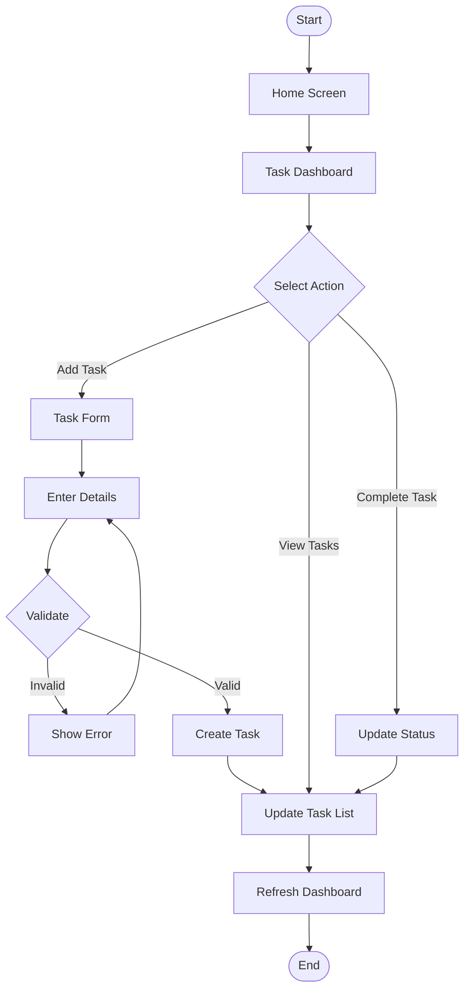

#  Student Task Manager

<p align="center">
  
  
  
  
</p>

<p align="center">
  <b>A simple Flutter application for organising academic tasks, assignments and deadlines.</b>
</p>

<p align="center">
  <a href="https://github.com/pothireddybhavyasri/student_task_manager">
    
  </a>
</p>

---

<p align="center">
  
</p>

Student Task Manager is a Flutter mobile application designed to help students organise academic and personal tasks, track completion and manage assignments in one place.

### 👩‍💻 Developer

| | Details |
|---|---|
| **Name** | Pothireddy Bhavya Sri |
| **College** | ACE Engineering College, Hyderabad |
| **Department** | Computer Science and Engineering |
| **Project Type** | Academic Mobile Application |
| **Domain** | Flutter & Dart |

---

<p align="center">
  
</p>

The aim of this project is to build a simple and responsive application that helps students **add, organise, track and complete their tasks** easily.

---

<p align="center">
  
</p>

-  **Task Management** — Add and view academic tasks.
-  **Task Tracking** — Mark tasks as completed.
-  **Academic Organisation** — Manage assignments and other student work.
-  **Navigation** — Move between screens using Navigator and named routes.
-  **Reusable UI** — Use reusable widgets and customised themes.
-  **Form Validation** — Validate task details before adding them.
-  **State Management** — Update the interface using Flutter state management.
-  **Responsive Design** — Adapt the interface for different screen sizes.

---

<p align="center">
  
</p>

<p align="center">
  
</p>

| Area | Technology |
|---|---|
| Framework | Flutter |
| Language | Dart |
| UI | Flutter Widgets |
| Navigation | Navigator / Named Routes |
| State | setState / Provider |
| Forms | Form / TextFormField |
| Styling | ThemeData / Custom Styles |
| IDE | VS Code / Android Studio |
| Version Control | Git / GitHub |

---

<p align="center">
  
</p>



###  Application Flow

1. Open the application.
2. View the task dashboard.
3. Add a new task.
4. Enter and validate task details.
5. View the updated task list.
6. Mark completed tasks.
7. Continue managing tasks from the dashboard.

---

<p align="center">
  
</p>

```text
student_task_manager/
├── android/
├── ios/
├── web/
├── lib/
│   ├── main.dart
│   ├── screens/
│   ├── widgets/
│   ├── models/
│   ├── services/
│   └── theme/
├── assets/
├── test/
├── pubspec.yaml
├── pubspec.lock
├── analysis_options.yaml
└── README.md
```

---

<p align="center">
  
</p>

### Requirements

- Flutter SDK
- Dart SDK
- VS Code or Android Studio
- Android Emulator or Android Device
- Git

### 1. Clone the Repository

```bash
git clone https://github.com/pothireddybhavyasri/student_task_manager.git
cd student_task_manager
```

### 2. Install Dependencies

```bash
flutter pub get
```

### 3. Check Flutter

```bash
flutter doctor
```

### 4. Run the Application

```bash
flutter run
```

### 5. Run Tests

```bash
flutter test
```

### 6. Build APK

```bash
flutter build apk --release
```

APK location:

```text
build/app/outputs/flutter-apk/app-release.apk
```

---

<p align="center">
  
</p>

> The following experiments contain the main Flutter concepts demonstrated in the project.

### 1. Flutter Setup

**Aim:** To understand how to set up a Flutter app and use basic widgets.

```dart
void main() {
  runApp(
    const MaterialApp(
      home: Scaffold(
        body: Center(
          child: Text("Welcome to Flutter"),
        ),
      ),
    ),
  );
}
```

**Key Concepts:** `runApp()`, `MaterialApp`, `Scaffold`, `Text`

---

### 2. Widgets & Layouts

**Aim:** To implement a layout using Row, Column and basic widgets.

```dart
Column(
  children: [
    const Text("Student Task Manager"),
    Row(
      mainAxisAlignment: MainAxisAlignment.spaceEvenly,
      children: const [
        Icon(Icons.home),
        Icon(Icons.task),
        Icon(Icons.person),
      ],
    ),
  ],
)
```

**Key Concepts:** `Row`, `Column`, `Icon`, `Text`

---

### 3. Responsive Design

**Aim:** To create a responsive layout using MediaQuery and LayoutBuilder.

```dart
LayoutBuilder(
  builder: (context, constraints) {
    return constraints.maxWidth > 600
        ? const Text("Desktop Layout")
        : const Text("Mobile Layout");
  },
)
```

**Key Concepts:** `MediaQuery`, `LayoutBuilder`

---

### 4. Navigation & Named Routes

**Aim:** To navigate between multiple screens.

```dart
// Navigate to another screen
Navigator.pushNamed(context, '/details');

// Return to previous screen
Navigator.pop(context);
```

**Key Concepts:** `Navigator.pushNamed()`, `Navigator.pop()`

---

### 5. Stateful & Stateless Widgets

**Aim:** To understand how to manage state using setState and Provider.

```dart
int count = 0;

void increment() {
  setState(() {
    count++;
  });
}

Text("Count: $count");
```

**Key Concepts:** `StatefulWidget`, `StatelessWidget`, `setState()`

---

### 6. Custom Widgets & Themes

**Aim:** To create custom widgets and customise the design.

```dart
ThemeData(
  primarySwatch: Colors.blue,
);

ElevatedButton(
  onPressed: () {},
  child: const Text("Add Task"),
);
```

**Key Concepts:** Custom Widgets, `ThemeData`, `ElevatedButton`

---

### 7. Forms & Validation

**Aim:** To create forms with validation.

```dart
TextFormField(
  decoration: const InputDecoration(
    labelText: "Task Name",
    border: OutlineInputBorder(),
  ),
  validator: (value) {
    if (value == null || value.isEmpty) {
      return "Enter task name";
    }

    return null;
  },
);
```

**Key Concepts:** `Form`, `TextFormField`

---

### 8. Animations

**Aim:** To create animations using Flutter animation widgets.

```dart
AnimatedContainer(
  duration: const Duration(seconds: 1),
  width: isExpanded ? 200 : 100,
  height: 100,
  color: Colors.blue,
);
```

**Key Concepts:** `AnimatedContainer`, `Duration`, `setState()`

---

### 9. REST API & JSON

**Aim:** To retrieve data from a REST API.

```dart
final response = await http.get(
  Uri.parse("https://jsonplaceholder.typicode.com/users"),
);

if (response.statusCode == 200) {
  final data = jsonDecode(response.body);
  print(data);
}
```

**Key Concepts:** HTTP Request, JSON Decode

---

### 10. Unit & Widget Testing

**Aim:** To perform unit and widget testing.

```dart
test('Addition test', () {
  expect(10 + 20, 30);
});

testWidgets('Text visibility test',
    (WidgetTester tester) async {
  await tester.pumpWidget(
    const MaterialApp(
      home: Text("Student Task Manager"),
    ),
  );

  expect(
    find.text("Student Task Manager"),
    findsOneWidget,
  );
});
```

**Key Concepts:** `flutter_test`, `testWidgets()`, `expect()`

### 🧪 Experiment Summary

| No. | Experiment | Main Concepts |
|---|---|---|
| 1 | Flutter Setup | MaterialApp, Scaffold |
| 2 | Widgets & Layouts | Row, Column |
| 3 | Responsive Design | MediaQuery, LayoutBuilder |
| 4 | Navigation | Navigator, Named Routes |
| 5 | State Management | setState, Provider |
| 6 | Custom Widgets | ThemeData |
| 7 | Forms & Validation | TextFormField |
| 8 | Animations | AnimatedContainer |
| 9 | REST API | HTTP, JSON |
| 10 | Testing | Unit & Widget Testing |

---

<p align="center">
  
</p>

The application can be checked using the following areas:

| Test Area | Purpose |
|---|---|
| UI | Check screens and widgets |
| Navigation | Check screen navigation |
| Forms | Check input and validation |
| Task Creation | Check task creation |
| Task Tracker | Check completion status |
| State | Check UI updates |
| Responsive UI | Check different screen sizes |
| Widgets | Check reusable components |

### Testing Commands

```bash
flutter analyze
flutter test
flutter doctor
```

---

<p align="center">
  
</p>

### 📱 Mobile View

<p align="center">
  
</p>

<p align="center">
  <em>Student Task Manager running on a mobile device</em>
</p>

### 💻 Desktop / Web View

<p align="center">
  
</p>

<p align="center">
  <em>Responsive dashboard on desktop</em>
</p>

### 📐 Responsive Design

The interface is designed to work across mobile and larger screens, making task management easier on different devices.

---

<p align="center">
  
</p>

Possible future improvements include:

- 📅 Calendar and task scheduling
- ⏰ Deadline reminders
- 🔎 Search and filtering
- 📚 Subject-wise task categories
- 📊 Progress and productivity tracking
- 🌙 Dark mode and additional themes

---

<p align="center">
  
</p>

Through this project, I learned how to build Flutter interfaces using Dart, work with widgets and layouts, navigate between screens, manage state, validate forms, create reusable components, add animations, work with REST APIs and perform basic testing.

---

<p align="center">
  
</p>

Student Task Manager demonstrates how Flutter can be used to build a simple, responsive and interactive academic application.

The project brings together **Flutter widgets, navigation, state management, validation, responsive design, animations, APIs and testing** in one application.

---

<p align="center">
  
</p>

1. [Flutter Documentation](https://docs.flutter.dev/)
2. [Dart Documentation](https://dart.dev/guides)
3. [Flutter Widgets](https://docs.flutter.dev/ui/widgets)
4. [Flutter Navigation](https://docs.flutter.dev/ui/navigation)
5. [Flutter Cookbook](https://docs.flutter.dev/cookbook)
6. [Material Design Guidelines](https://m3.material.io/)

---

<p align="center">
  
</p>

<p align="center">
  <b>Developed by Pothireddy Bhavya Sri</b><br>
  Computer Science and Engineering | ACE Engineering College, Hyderabad
</p>
