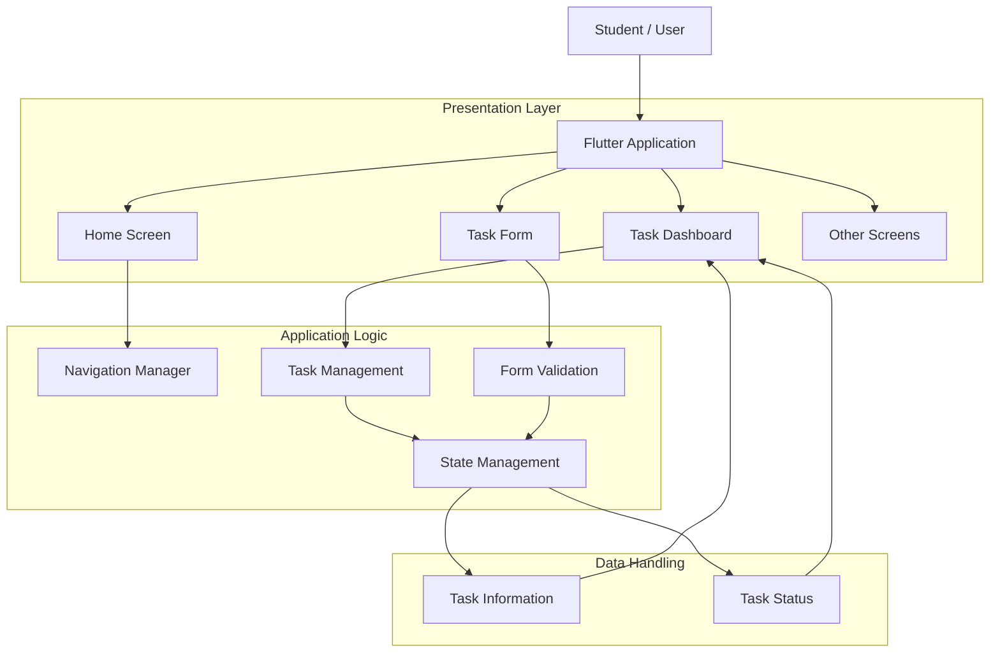
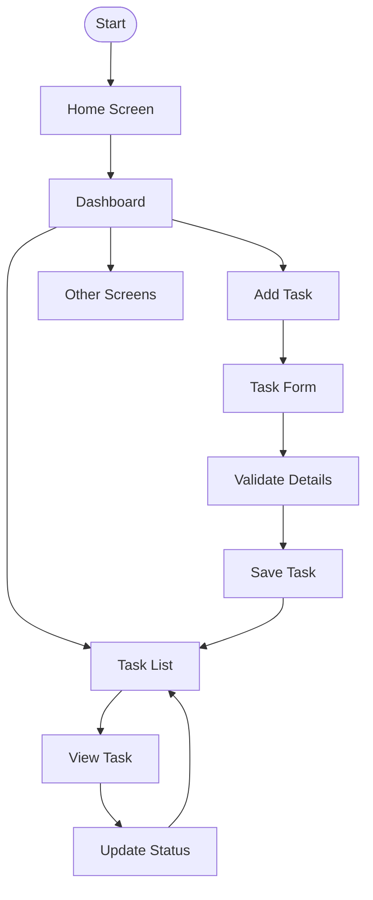
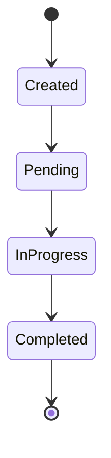
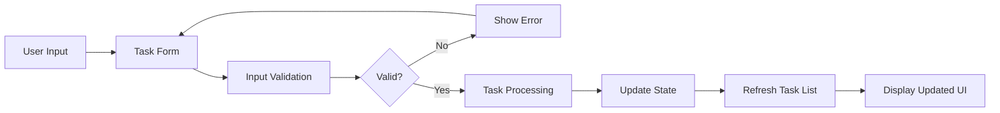
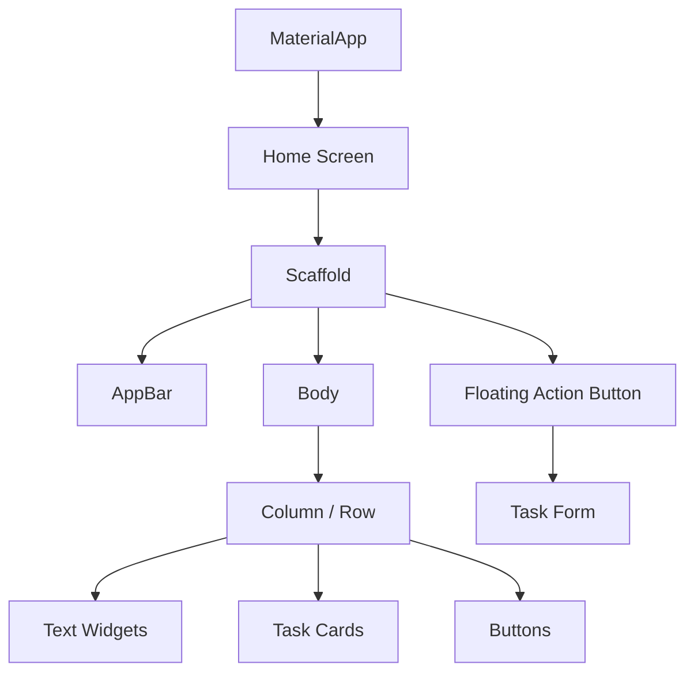
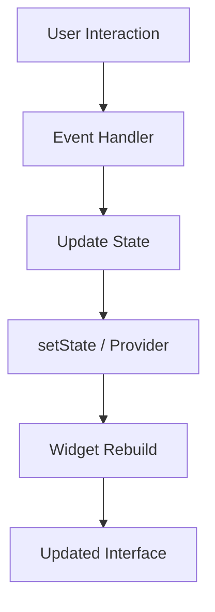
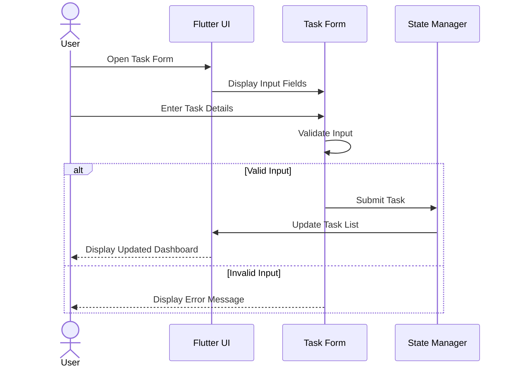

# 🎓 Student Task Manager
### Organize Your Tasks. Stay Focused. Meet Every Deadline.

<p align="center">
  
  
  
</p>

<p align="center">
  <b>A smart Flutter application for organizing academic tasks, assignments, and deadlines.</b>
</p>

<p align="center">
  <a href="https://github.com/pothireddybhavyasri/student_task_manager">GitHub Repository</a>
</p>

---

## 📑 Table of Contents

1. Project Overview
2. Objectives
3. Key Features
4. Technology Stack
5. Application Workflow
6. System Architecture
7. Mermaid Visualizations
8. Application Modules
9. Repository Structure
10. Getting Started
11. Flutter Experiments (1–10)
12. Testing and Verification
13. Learning Outcomes
14. Future Enhancements
15. Conclusion
16. References

---

## 📌 1. Project Overview

Student Task Manager is a Flutter-based mobile application designed to help students organize academic responsibilities, manage assignments, track task completion, and improve time management.

Students regularly handle assignments, laboratory records, examinations, projects, and personal activities. This application provides a centralized interface to organize tasks and maintain a structured academic workflow.

**Developed by:** Pothireddy Bhavya Sri  
**College:** ACE Engineering College, Hyderabad  
**Department:** Computer Science and Engineering  
**Project Type:** Academic Mobile Application  
**Domain:** Flutter | Dart | Mobile Application Development

---

## 🎯 2. Project Objectives

- Organize academic tasks and personal activities.
- Create and manage tasks through an interactive interface.
- Track pending and completed activities.
- Simplify task creation and monitoring.
- Implement navigation between application screens.
- Apply reusable widgets and custom styling.
- Demonstrate state management and form validation.
- Develop a responsive mobile application.

---

## 🌟 3. Key Features

- **Task Management:** Create, organize, and view academic tasks.
- **Academic Organization:** Maintain an overview of assignments and responsibilities.
- **Task Tracking:** Identify pending tasks and mark activities completed.
- **Navigation:** Move between screens using Navigator and named routes.
- **Custom Widgets:** Reuse UI components and apply consistent styling.
- **Form Validation:** Accept task information and validate required fields.
- **State Management:** Update the interface using setState or Provider where implemented.
- **Responsive Interface:** Adapt layouts to different display sizes.

---

## 🏷️ 4. Technology Stack

<p align="center">
  
</p>

| Layer | Technology | Purpose |
|---|---|---|
| Framework | Flutter | Mobile application development |
| Language | Dart | Application logic |
| UI | Flutter Widgets | Application screens |
| Navigation | Navigator / Named Routes | Screen navigation |
| State Management | setState / Provider | Updating application state |
| Forms | Form / TextFormField | Input and validation |
| Styling | ThemeData / Custom Styles | Application appearance |
| IDE | VS Code / Android Studio | Development and debugging |
| Version Control | Git and GitHub | Source code management |

---

## 🔄 5. Application Workflow


### Workflow Explanation

1. Launch the application and display the home screen.
2. Open the task dashboard and select an action.
3. Enter task details through the task form.
4. Validate the entered information.
5. Add the task and update the task list.
6. Update task status when an activity is completed.
7. Display the updated dashboard.

---

## 🏗️ 6. System Architecture



| Layer | Responsibility |
|---|---|
| Presentation | Displays screens and widgets |
| Application Logic | Handles navigation and task operations |
| State Management | Updates the interface when data changes |
| Data Handling | Manages task information and status |

*This is a logical architecture. Include persistent storage only if it is implemented in the project.*

---

## 📊 7. Mermaid Visualizations

### 7.1 Navigation Flow



### 7.2 Task Lifecycle



### 7.3 Task Data Flow



### 7.4 Widget Composition



### 7.5 State Management



### 7.6 Task Creation Sequence



---

## 🧩 8. Application Modules

| Module | Description |
|---|---|
| Home Screen | Main entry point |
| Dashboard | Displays task information |
| Task Management | Handles task creation and organization |
| Navigation | Controls movement between screens |
| Form Module | Accepts and validates user input |
| State Management | Updates the application interface |
| Custom Widgets | Provides reusable UI components |
| Theme Module | Maintains consistent styling |

---

## 📁 9. Repository Structure

```text
student_task_manager/
├── android/
├── ios/
├── web/
├── lib/
│   ├── main.dart
│   ├── screens/
│   ├── widgets/
│   ├── models/
│   ├── services/
│   └── theme/
├── assets/
├── test/
├── pubspec.yaml
├── pubspec.lock
├── analysis_options.yaml
└── README.md
```

*Representative structure: update it to match the actual repository files and folders.*

---

## 🚀 10. Getting Started

### Prerequisites

- Flutter SDK and Dart SDK
- Android Studio or Visual Studio Code
- Android Emulator or physical Android device
- Git

### 1. Clone the Repository

```bash
git clone https://github.com/pothireddybhavyasri/student_task_manager.git
cd student_task_manager
```

### 2. Install Dependencies

```bash
flutter pub get
```

### 3. Check Flutter Setup

```bash
flutter doctor
```

### 4. Run the Application

```bash
flutter run
```

### 5. Run Tests

```bash
flutter test
```

### 6. Build APK

```bash
flutter build apk --release
```

Generated APK location:

```text
build/app/outputs/flutter-apk/app-release.apk
```

---

## 💻 11. Flutter Experiments (1–10)

This section contains compact code highlights for the ten Flutter laboratory experiments.

### Experiment 1: Flutter Application Setup

**Aim:** Understand Flutter application setup and basic widgets.

```dart
void main() {
  runApp(const MaterialApp(
    home: Scaffold(
      body: Center(child: Text("Welcome to Flutter")),
    ),
  ));
}
```

**Concepts:** `runApp()`, `MaterialApp`, `Scaffold`, `Text`.

### Experiment 2: Flutter Widgets and Layouts

**Aim:** Implement layouts using Row, Column, and basic widgets.

```dart
Column(
  children: [
    const Text("Student Task Manager"),
    Row(
      mainAxisAlignment: MainAxisAlignment.spaceEvenly,
      children: const [
        Icon(Icons.home),
        Icon(Icons.task),
        Icon(Icons.person),
      ],
    ),
  ],
)
```

**Concepts:** `Row`, `Column`, `Icon`, `Text`.

### Experiment 3: Responsive UI

**Aim:** Create responsive layouts using MediaQuery and LayoutBuilder.

```dart
LayoutBuilder(
  builder: (context, constraints) {
    return constraints.maxWidth > 600
        ? const Text("Desktop Layout")
        : const Text("Mobile Layout");
  },
)
```

**Concepts:** `MediaQuery`, `LayoutBuilder`, responsive design.

### Experiment 4: Navigation and Named Routes

**Aim:** Navigate between multiple application screens.

```dart
// Navigate to another screen
Navigator.pushNamed(context, '/details');

// Return to previous screen
Navigator.pop(context);
```

**Concepts:** `Navigator.pushNamed()`, `Navigator.pop()`.

### Experiment 5: Stateful and Stateless Widgets

**Aim:** Understand state management using setState and Provider.

```dart
int count = 0;

void increment() {
  setState(() {
    count++;
  });
}

Text("Count: $count");
```

**Concepts:** `StatefulWidget`, `StatelessWidget`, `setState()`.

### Experiment 6: Custom Widgets and Themes

**Aim:** Create reusable widgets and apply custom styling.

```dart
ThemeData(
  primarySwatch: Colors.blue,
);

ElevatedButton(
  onPressed: () {},
  child: const Text("Add Task"),
);
```

**Concepts:** Custom widgets, `ThemeData`, `ElevatedButton`.

### Experiment 7: Forms and Validation

**Aim:** Create forms with input fields and validation.

```dart
TextFormField(
  decoration: const InputDecoration(
    labelText: "Task Name",
    border: OutlineInputBorder(),
  ),
  validator: (value) {
    if (value == null || value.isEmpty) {
      return "Enter task name";
    }
    return null;
  },
);
```

**Concepts:** `Form`, `TextFormField`, validation.

### Experiment 8: Flutter Animations

**Aim:** Implement animations using Flutter animation widgets.

```dart
AnimatedContainer(
  duration: const Duration(seconds: 1),
  width: isExpanded ? 200 : 100,
  height: 100,
  color: Colors.blue,
);
```

**Concepts:** `AnimatedContainer`, `Duration`, `setState()`.

### Experiment 9: REST API and JSON

**Aim:** Fetch and process data from a REST API.

```dart
final response = await http.get(
  Uri.parse("https://jsonplaceholder.typicode.com/users"),
);

if (response.statusCode == 200) {
  final data = jsonDecode(response.body);
  print(data);
}
```

**Concepts:** HTTP requests, JSON decoding, API integration.

### Experiment 10: Unit and Widget Testing

**Aim:** Perform unit testing and widget testing.

```dart
test('Addition test', () {
  expect(10 + 20, 30);
});

testWidgets('Text visibility test',
    (WidgetTester tester) async {
  await tester.pumpWidget(
    const MaterialApp(
      home: Text("Student Task Manager"),
    ),
  );

  expect(
    find.text("Student Task Manager"),
    findsOneWidget,
  );
});
```

**Concepts:** `flutter_test`, `testWidgets()`, `expect()`.

### Experiment Summary

| Experiment | Topic | Main Concepts |
|---|---|---|
| 1 | Flutter Setup | MaterialApp, Scaffold |
| 2 | Widgets and Layouts | Row, Column, Stack |
| 3 | Responsive UI | MediaQuery, LayoutBuilder |
| 4 | Navigation | Navigator, Named Routes |
| 5 | State Management | setState, Provider |
| 6 | Custom Widgets | ThemeData, Custom Styles |
| 7 | Forms | TextFormField, Validation |
| 8 | Animations | AnimatedContainer |
| 9 | REST API | HTTP, JSON |
| 10 | Testing | Unit Testing, Widget Testing |

*These are concise illustrative snippets, not complete application programs. Adapt them to the actual laboratory implementation and dependencies.*

---

## 🧪 12. Testing and Verification

| Testing Area | What to Verify |
|---|---|
| UI Testing | Screen layouts and widget rendering |
| Navigation Testing | Movement between screens |
| Form Testing | Input fields and validation |
| Task Creation | Adding new tasks |
| State Management | Updating application state |
| Task Tracking | Completion status |
| Responsive Testing | Layout on different screen sizes |
| Widget Testing | Reusable widget behavior |
| Integration Testing | Complete application workflow |

### Testing Commands

```bash
flutter analyze
flutter test
flutter doctor
```

---

## 🎓 13. Learning Outcomes

- Understanding Flutter application architecture.
- Working with Dart programming language.
- Developing interfaces using Flutter widgets.
- Implementing navigation between screens.
- Understanding StatefulWidget and StatelessWidget.
- Applying state management techniques.
- Creating forms and validating user input.
- Designing reusable custom widgets.
- Applying themes and custom styling.
- Understanding animations and API integration.
- Performing unit and widget testing.
- Debugging Flutter applications.

---

## 🗺️ 14. Future Enhancements

- [ ] Local database integration for persistent task storage.
- [ ] Calendar-based task scheduling.
- [ ] Task priority classification.
- [ ] Deadline reminders and notifications.
- [ ] Search and filter functionality.
- [ ] Subject-wise task categorization.
- [ ] Progress tracking and productivity analytics.
- [ ] Cloud synchronization.
- [ ] User authentication.
- [ ] Dark mode and additional themes.

---

## 🏁 15. Conclusion

Student Task Manager is a Flutter-based academic productivity application designed to simplify task organization and improve student time management.

The project demonstrates practical implementation of Flutter widgets, navigation, state management, form validation, custom styling, responsive layouts, animations, and testing concepts.

It provides hands-on experience in mobile application development and demonstrates how Flutter can be used to build structured and interactive applications.

Future improvements can introduce persistent database storage, reminders, calendar scheduling, and productivity analytics to make the application more comprehensive.

---

## 📖 16. References

1. [Flutter Official Documentation](https://docs.flutter.dev/)
2. [Dart Official Documentation](https://dart.dev/guides)
3. [Flutter Widget Catalog](https://docs.flutter.dev/ui/widgets)
4. [Flutter Navigation Documentation](https://docs.flutter.dev/ui/navigation)
5. [Flutter Cookbook](https://docs.flutter.dev/cookbook)
6. [Material Design Guidelines](https://m3.material.io/)

---

## 👩‍💻 Developer

**Pothireddy Bhavya Sri**  
Computer Science and Engineering  
ACE Engineering College, Hyderabad

<p align="center">
  <b>Built with Flutter 💙</b><br/>
  Organize Your Tasks. Stay Focused. Meet Every Deadline.
</p>

