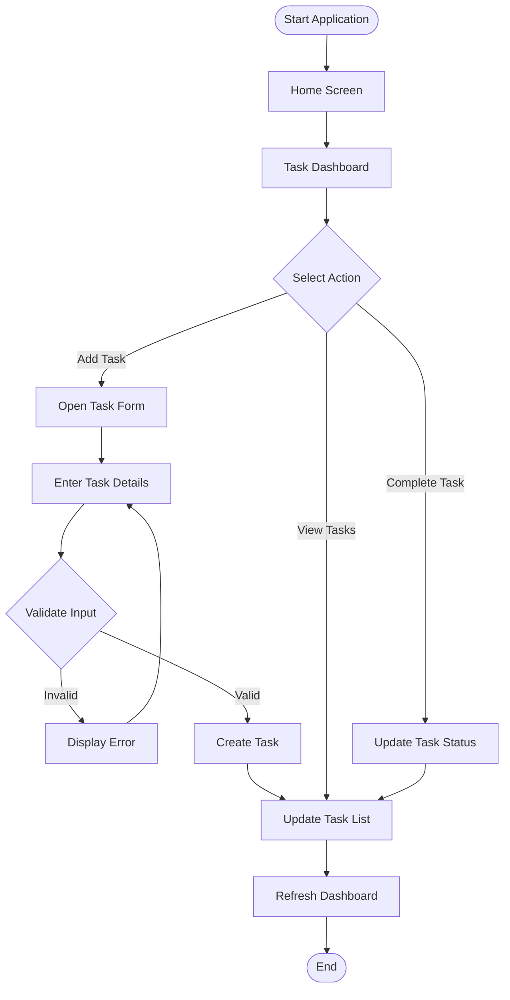
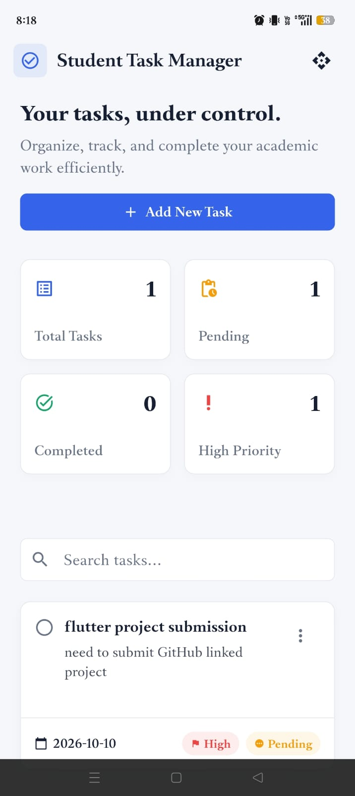

# Student Task Manager

Smart Flutter app for managing academic tasks, assignments and deadlines!
GitHub
---
<p align="center">
  
  
  
</p>

<p align="center">
  <b>A smart Flutter application for organizing academic tasks, assignments, and deadlines.</b>
</p>

<p align="center">
  <a href="https://github.com/pothireddybhavyasri/student_task_manager">GitHub Repository</a>
</p>
---

## 1. Overview

Student Task Manager is a Flutter mobile application that helps students organise academic tasks, manage assignments and track completion of tasks.

As a student you will complete many assignments, lab work, exams, projects and personal tasks. This application provides an interface that can be used to organise these tasks.

Developer:

Name: Pothireddy Bhavya Sri
College: ACE Engineering College, Hyderabad
Department: Computer Science and Engineering
Project: Academic Mobile Application
Domain:

Flutter
Dart
Mobile Application Development
---
## 2. Aims
The aim of the Student Task Manager application is to help students organise tasks, both academic and personal.  The application has a reponsive layout to allow students to easily manage their tasks.

## 3. Features
Task Management - Create, manage and view tasks.
Academic Organisation - Keep track of assignments.
Task Tracker - See what tasks are outstanding and mark them as complete.
Navigation - Use navigator and named routes to navigate between screens.
Reusable Widgets - Create reusable widgets and customise the design.
Validation - Use form to add task details and validate.
State Management - Update interface by using setState or Provider (where applicable).
Responsive - Responsive application.
## 4. Technologies Used

<p align="center">
  
</p>

| Layer | Tech | Description |
|-----|-----|--------|
| Framework | Flutter | Mobile Application |
| Language | Dart | Logic |
| UI | Flutter Widgets | Screens |
| Navigation | Navigator / Named Routes | Navigate Between Screens |
| State Management | setState / Provider | Manage Application State |
| Forms | Form / TextFormField | Add Tasks |
| Styling | ThemeData / Custom Styles | Add custom design to application |
| IDE | VS Code / Android Studio | Create Application |
| Source Control | Git / GitHub | Source Control |
---
## 5. Flow Diagram

## 6. File Structure
```text
student_task_manager/
├── android/
├── ios/
├── web/
├── lib/
│   ├── main.dart
│   ├── screens/
│   ├── widgets/
│   ├── models/
│   ├── services/
│   └── theme/
├── assets/
├── test/
├── pubspec.yaml
├── pubspec.lock
├── analysis_options.yaml
└── README.md
```
## 7. How to Get Started
### Requirements
Flutter SDK
Dart SDK
Android Studio or Visual Studio Code
Android Emulator or Android Device
Git
### 1. Clone Repo
```bash
git clone https://github.com/pothireddybhavyasri/student_task_manager.git
cd student_task_manager
```
### 2. Install Dependencies
```bash
flutter pub get
```
### 3. Check Flutter Installation
```bash
flutter doctor
```
### 4. Run App
```bash
flutter run
```
### 5. Run Tests
```bash
flutter test
```
### 6. Generate APK
```bash
flutter build apk --release
```
APK Generated at:
```text
build/app/outputs/flutter-apk/app-release.apk
```
---
## 8. Flutter Lab Experiments (1-10)
Below are some short snippets of code for each of the 10 Flutter Labs.
### 1. Flutter Setup
Aim: To understand how to set up a Flutter app and use basic widgets.
```dart
void main() {
runApp(const MaterialApp(
home: Scaffold(
body: Center(child: Text("Welcome to Flutter")),
),
));
}
```
runApp(), MaterialApp, Scaffold, Text
### 2. Widgets & Layouts
Aim: To implement a layout using Row, Column and basic widgets.
```dart
Column(
children: [
const Text("Student Task Manager"),
Row(
mainAxisAlignment: MainAxisAlignment.spaceEvenly,
children: const [
Icon(Icons.home),
Icon(Icons.task),
Icon(Icons.person),
],
),
],
)
```
Row, Column, Icon, Text
### 3. Responsive Design
Aim: To create a responsive layout using MediaQuery and LayoutBuilder.
```dart
LayoutBuilder(
builder: (context, constraints) {
return constraints.maxWidth > 600
? const Text("Desktop Layout")
: const Text("Mobile Layout");
},
)
```
MediaQuery, LayoutBuilder
### 4. Navigation & Named Routes
Aim: To navigate between multiple screens.
```dart
// Navigate to another screen
Navigator.pushNamed(context, '/details');
// Return to previous screen
Navigator.pop(context);
```
Navigator.pushNamed(), Navigator.pop()
### 5. Stateful & Stateless Widgets
Aim: To understand how to manage state using setState and Provider.
```dart
int count = 0;
void increment() {
setState(() {
count++;
});
}
Text("Count: $count");
```
StatefulWidget, StatelessWidget, setState()
### 6. Custom Widgets & Themes
Aim: Create custom widgets and customise the design.
```dart
ThemeData(
primarySwatch: Colors.blue,
);
ElevatedButton(
onPressed: () {},
child: const Text("Add Task"),
);
```
Custom Widgets, ThemeData, ElevatedButton
### 7. Forms & Validation
Aim: Create forms with validation.
```dart
TextFormField(
decoration: const InputDecoration(
labelText: "Task Name",
border: OutlineInputBorder(),
),
validator: (value) {
if (value == null || value.isEmpty) {
return "Enter task name";
}
return null;
},
);
```
Form, TextFormField
### 8. Animations
Aim: Create animations using Flutter animation widgets.
```dart
AnimatedContainer(
duration: const Duration(seconds: 1),
width: isExpanded ? 200 : 100,
height: 100,
color: Colors.blue,
);
```
AnimatedContainer, Duration, setState()
### 9. REST API & JSON
Aim: Retrieve data from a REST API.
```dart
final response = await http.get(
Uri.parse("https://jsonplaceholder.typicode.com/users"),
);
if (response.statusCode == 200) {
final data = jsonDecode(response.body);
print(data);
}
```
HTTP request, Decode JSON
### 10. Unit & Widget Testing
Aim: Perform unit and widget testing.
```dart
test('Addition test', () {
expect(10 + 20, 30);
});
testWidgets('Text visibility test',
(WidgetTester tester) async {
await tester.pumpWidget(
const MaterialApp(
home: Text("Student Task Manager"),
),
);
expect(
find.text("Student Task Manager"),
findsOneWidget,
);
});
```
flutter_test, testWidgets(), expect()
### Summary
---
## 9. Testing
| Test | Check |
|----|-----|
| UI | Check screens and widgets |
| Navigation | Navigating between screens |
| Forms | Check inputs and validation |
| Task Creation | Check tasks can be created |
| State Management | Check application state can be managed |
| Task Tracker | Check tasks are marked as complete |
| Responsive | Check responsive design |
| Widgets | Check widgets can be reused |
| Integration | Check full application works |
### Commands:
```bash
flutter analyze
flutter test
flutter doctor
```
## 10. Screenshots
### Mobile View

<p align="center">
  
</p>

<p align="center">
  <em>Student Task Manager running on a mobile device</em>
</p>

### Desktop / Web View

<p align="center">
  
</p>

<p align="center">
  <em>Student Task Manager responsive dashboard on desktop</em>
</p>


## 11. What I Have Learned

Understand Flutter application structure
Used Dart
Created interfaces with Flutter widgets
Navigated between screens
Understand StatefulWidget and StatelessWidget
Managed state
Created forms and validated
Created custom widgets
Customised design
Learned about animations
Understood REST API
Performed unit and widget testing
Debugged Flutter application
---
## 12. Future Improvements
Add local database
Add calendar
Add priority to tasks
Add reminder for deadlines
Add search and filter
Categorise tasks by subject
Add progress and productivity
Cloud sync
User authentication
Dark mode and additional themes
---
## 13. Conclusion
The Student Task Manager is a Flutter based academic productivity tool, that can help students manage their tasks.
The project shows how to use Flutter widgets, navigation, state management, form validation, custom widgets, responsive design, animations and testing.
The project gives an insight into developing a mobile application and shows how Flutter can be used to create structured and interactive applications.
Improvements can be made to the application such as adding a local database, reminders, calendar and productivity analytics.
---
## 15. References
[Flutter Docs](https://docs.flutter.dev/)
[Dart Docs](https://dart.dev/guides)
[Flutter Widgets](https://docs.flutter.dev/ui/widgets)
[Flutter Navigation](https://docs.flutter.dev/ui/navigation)
[Flutter Cookbook](https://docs.flutter.dev/cookbook)
[Material Guidelines](https://m3.material.io/)
---
## Developer:
Pothireddy Bhavya Sri
Computer Science and Engineering
ACE Engineering College, Hyderabad
Built with Flutter 💙
Organise Tasks. Stay Focused. Meet Deadlines.
sks. Stay Focused. Meet Deadlines.
